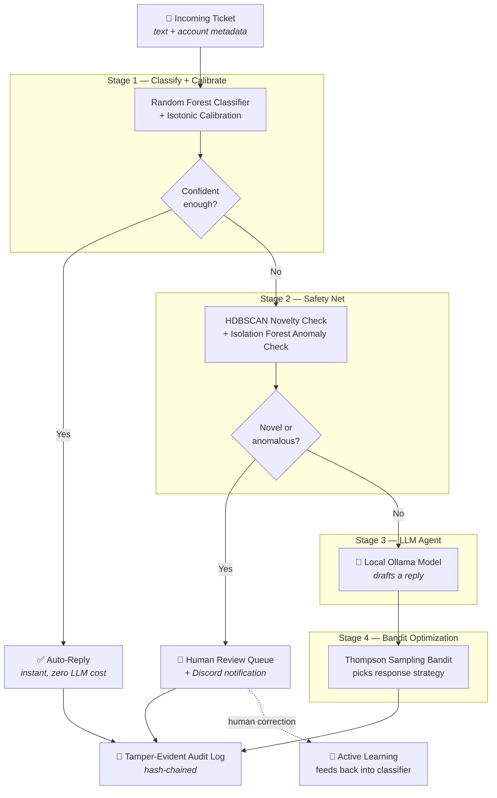

<div align="center">

# 🌊 Cascade
### A self-optimizing ticket triage system that only calls an LLM when it actually has to

*Most "AI automation" sends every request to an LLM. Cascade doesn't.*

[](https://www.python.org/)
[](https://fastapi.tiangolo.com/)
[](https://n8n.io/)
[-000000)](https://ollama.com/)
[](LICENSE)

</div>

---

## 💡 The problem

Every "AI-powered support" demo does the same thing: pipe 100% of incoming requests through an LLM and hope for the best. That's slow, expensive, and unnecessary — most tickets are routine and don't need a language model's judgment at all.

**Cascade** flips this around. It's a decision pipeline where cheap, fast, classical ML handles what it confidently can, a safety net catches what it shouldn't guess on, and an LLM only gets involved for the genuinely ambiguous cases left over.

> In a 500-ticket load test using held-out phrasing, **59% of tickets never touched the LLM at all** — with **100% classification accuracy** on the auto-resolved decisions.

---

## 🗺️ How it works



**The core idea:** each stage only sees what the stage before it couldn't confidently resolve. By the time a ticket reaches the LLM, it's already been filtered twice — which is exactly why the expensive step stays the *least*-used one, not the default one.

---

## ⚙️ The four stages, explained

| Stage | What it does | Technique |
|---|---|---|
| **1️⃣ Classify + Calibrate** | Predicts a category and asks "how sure am I, really?" — using **calibrated** confidence, not raw overconfident probabilities | Random Forest + Isotonic Calibration |
| **2️⃣ Safety Net** | Two independent checks: *"have I seen anything like this before?"* and *"is this account behaving unusually?"* — either one routes to a human instead of guessing | HDBSCAN clustering + Isolation Forest |
| **3️⃣ LLM Agent** | Only reached by tickets that are ambiguous but *not* dangerous or novel — drafts a real, context-aware reply | Local Ollama model, orchestrated in n8n |
| **4️⃣ Bandit Optimization** | Learns *which* response strategy actually resolves tickets fastest, and *what confidence threshold* is actually trustworthy — both from real outcomes, not hardcoded guesses | Thompson Sampling (Multi-Armed Bandit) |

Every decision — at every stage — is written to a **tamper-evident, hash-chained audit log**, so nothing can be silently edited after the fact. Flagged tickets land in a **human review queue** with active-learning feedback, so corrections actually improve the classifier over time.

---

## 🏆 Results

Measured with a 500-ticket load test on held-out phrasing (not seen during training):

| Metric | Result |
|---|---|
| Tickets resolved without touching the LLM | **59.0%** |
| Classification accuracy on auto-resolved decisions | **100%** |
| Overall classification accuracy | **100%** |
| Latency regression found & fixed via load testing | **46% reduction** in non-LLM-path latency |

> 🔍 **A real bug I found through load testing:** the audit log was re-reading its entire file on every single write just to find the last entry — an O(n) bottleneck that compounded as the log grew. Fixed by caching the last hash in memory, cutting non-LLM-path latency by 46%.

---

## 🛠️ Tech Stack

```
Language          Python 3.11+
API                FastAPI
Classifier         scikit-learn (Random Forest + Isotonic Calibration)
Clustering         HDBSCAN
Anomaly Detection  Isolation Forest
Embeddings         sentence-transformers / Ollama (nomic-embed-text)
LLM                Ollama (local — Qwen 2.5 / Llama 3.1, fully offline)
Orchestration      n8n (self-hosted, Docker)
Audit Trail        Custom hash-chained JSONL log
Frontend           Vanilla HTML/CSS/JS control-room dashboard
Notifications      Discord webhook
```

**Zero paid APIs.** Every model runs locally via Ollama — no OpenAI/Anthropic key required to run this end-to-end.

---

## 📸 The Dashboard

A live control-room view of the cascade — submit a ticket and watch it move through each stage in real time, with skipped stages dimming out so you can *see* the cost-saving happening, not just read about it.

```
┌─────────────────────┐      ┌────────────────────────────────────┐
│   SUBMIT TICKET      │      │   DECISION PIPELINE                 │
│                       │      │                                      │
│  [ticket text box]    │      │  01 ● Classify + calibrate  billing 99.8% │
│  Account age: [400]   │ ──▶  │  02 ○ Novelty + anomaly      skipped │
│  Prior tickets: [1]   │      │  03 ○ LLM agent              skipped │
│                       │      │  04 ○ Strategy bandit        skipped │
│  [ RUN TRIAGE → ]     │      │                                      │
└─────────────────────┘      │  ✅ AUTO-RESOLVED                    │
                               │  Reply: "Thanks for reaching out..." │
                               └────────────────────────────────────┘
```

Also includes a **Pending Human Review** panel — flagged tickets can be reviewed, corrected, and resolved right from the dashboard, feeding straight back into the audit log and future retraining data.

---

## 🚀 Getting Started

```bash
# 1. Clone and set up the Python environment
git clone https://github.com/yourusername/cascade.git
cd cascade
python -m venv venv
source venv/bin/activate      # Windows: venv\Scripts\Activate.ps1
pip install -r ml_service/requirements.txt

# 2. Pull a local LLM + embedding model via Ollama
ollama pull qwen2.5:7b-instruct
ollama pull nomic-embed-text

# 3. Generate synthetic training data and train the classifier
python training/generate_synthetic_tickets.py
python training/train_classifier.py
python training/fit_unsupervised_models.py

# 4. Start the API
cd ml_service
uvicorn main:app --reload --port 8000

# 5. Start n8n (orchestration layer)
docker run -it --rm --name n8n -p 5678:5678 -v n8n_data:/home/node/.n8n docker.n8n.io/n8nio/n8n

# 6. Open the dashboard
open frontend/cascade_dashboard.html
```

Full step-by-step build guide with every line of code explained: [`docs/BUILD_GUIDE.md`](docs/BUILD_GUIDE.md)

---

## 📂 Project Structure

```
cascade/
├── ml_service/              # FastAPI service — the decision engine
│   ├── main.py               # /triage, /feedback, /review-queue endpoints
│   ├── embeddings.py          # text → vector
│   ├── clustering.py          # HDBSCAN novelty detection
│   ├── anomaly.py             # Isolation Forest anomaly detection
│   ├── threshold_bandit.py    # adaptive confidence thresholds
│   ├── bandit.py              # response-strategy bandit
│   ├── reward.py               # multi-objective reward function
│   └── audit_log.py           # hash-chained tamper-evident log
├── training/                # offline training + evaluation scripts
│   ├── generate_synthetic_tickets.py
│   ├── train_classifier.py
│   ├── fit_unsupervised_models.py
│   ├── load_test.py           # the 500-ticket benchmark
│   └── retrain_job.py         # weekly active-learning retrain
├── frontend/
│   └── cascade_dashboard.html  # live pipeline visualization
├── n8n_workflows/             # exported orchestration workflows
└── storage/                   # trained models, audit log, bandit state
```

---

## 🎯 Why this exists

Cascade applies a well-established idea — cascade routing, escalating to a stronger model only on low confidence — and combines it with two things I couldn't find pre-built anywhere:

1. **Bandit-optimized confidence thresholds** that adapt from real outcomes, instead of a number picked once and left forever
2. **A tamper-evident audit trail + human review loop** wrapped around the whole pipeline — the parts of "production AI" that most portfolio projects skip entirely

It's built to demonstrate that shipping AI responsibly means thinking about cost, safety, and auditability — not just accuracy.

---

## ⚠️ Honest Limitations

- Trained on synthetic data with fairly distinct category vocabulary — real-world messy phrasing (typos, sarcasm, mixed-topic tickets) would be a harder, more realistic test
- The 100% accuracy figure reflects a clean test set, not adversarial real-world traffic — a production deployment would need a much noisier benchmark before trusting that number
- LLM inference runs on CPU via Ollama in this setup — latency would improve significantly with GPU acceleration

---

## 📄 License

MIT — see [LICENSE](LICENSE) for details.

<div align="center">

*Built as a demonstration of cost-aware, safety-conscious AI system design.*

</div>
